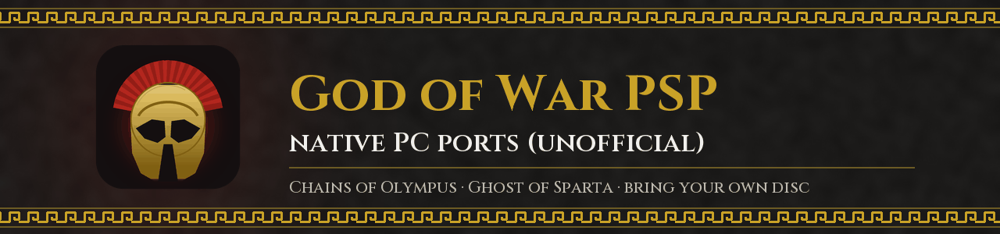
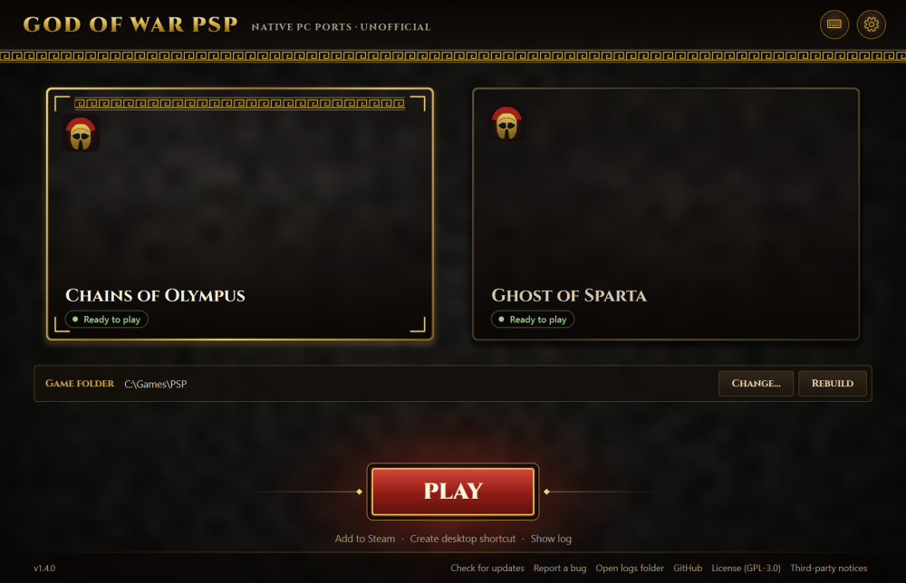
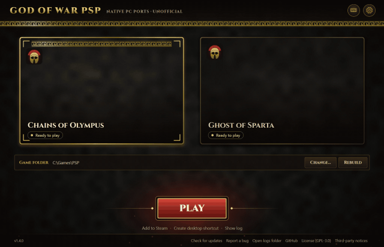
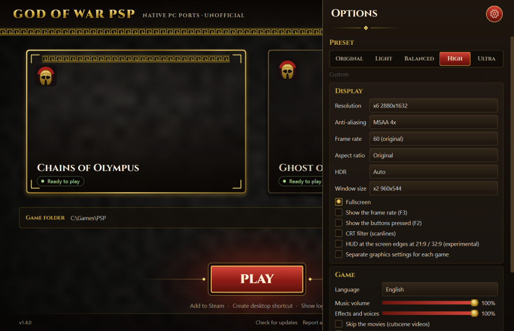
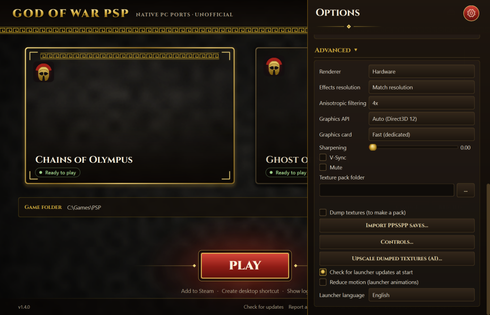

# God of War PSP: native PC ports (unofficial)

Play **God of War: Chains of Olympus** and **God of War: Ghost of Sparta** natively on Windows, recompiled from your own
PSP disc, with 4K, MSAA, HDR and high frame rates.

**[⬇ Download the launcher (v1.6.0)](https://github.com/DrummingBird1/gow-psp-recomp/releases/latest)**: one ZIP, no
installation. Then follow the [quick start](#quick-start).

> **Unofficial fan project.** Not affiliated with or endorsed by Sony Interactive Entertainment or Santa Monica Studio.
> God of War is a trademark of its owner. **No game content is included or downloadable here:** you need your own,
> legally dumped disc image (`.chd` or `.iso`). Everything built from it stays on your PC.

## Requirements

- Windows 10 or 11, 64-bit (Linux / Steam Deck are planned).
- A graphics card with Direct3D 12 or Vulkan. Integrated graphics run the Light preset at 60 FPS.
- About 1.5 GB of free space for the build tools and both games.
- Your own disc image of a supported release:

  | Game | US | Europe (preview) |
  |---|---|---|
  | Chains of Olympus | UCUS98653 | UCES00842 |
  | Ghost of Sparta | UCUS98737 | UCES01401, UCES01473 |

## Quick start

You only download **one file**, the launcher. No Python, no manual setup.

1. Download [`GoW_PSP_Launcher-v1.6.0.zip`](https://github.com/DrummingBird1/gow-psp-recomp/releases/latest/download/GoW_PSP_Launcher-v1.6.0.zip)
   from the [latest release](https://github.com/DrummingBird1/gow-psp-recomp/releases/latest) and extract it anywhere: you get
   one `GoW_PSP` folder with `GoWLauncher.exe` and a short `README.txt`.
   Everything the launcher creates (sources, builds, saves, settings) goes into `GoW_PSP_data` next to the exe.
2. Run `GoWLauncher.exe` and choose the folder with **your own disc images** (`.chd` or `.iso`). It detects each game by
   its disc ID, not by the file name.
3. Press **Build**. The first time, the launcher asks to download its portable build tools (**about 246 MB**, once):
   [llvm-mingw](https://github.com/mstorsjo/llvm-mingw), CMake and Ninja, from their official releases, checked against
   pinned SHA-256 hashes. **No Visual Studio, no administrator rights, nothing installed in Windows.**
4. Wait for the one-time build: a few minutes per game.
5. Pick a graphics preset and press **Play**. Later versions are offered by the launcher itself; your saves and settings
   stay.

Why build on your PC? The game code is generated from your own disc, so it can't be distributed; the launcher compiles
it locally, once.

> **Windows warning?** `GoWLauncher.exe` is unsigned and built with PyInstaller, so Windows SmartScreen may show
> "Windows protected your PC" (click **More info**, then **Run anyway**), and some antivirus programs flag
> PyInstaller programs as a false positive. Check that your download is the real one (v1.6.0 SHA-256):
> - `GoW_PSP_Launcher-v1.6.0.zip`: `1826b86d09b5ee6ce80b7828620f5f80660baac1bbe590b3bd9645fb5851ebcb`
> - `GoW_PSP\GoWLauncher.exe`: `071f8371dff5cd303db02fc60b22b45cf1481b397796ae39c25a1283f121215b`
>
> (PowerShell: `Get-FileHash <file>`). Each release lists its hashes in the release notes.

Problems? See [Troubleshooting and FAQ](docs/troubleshooting.md): SmartScreen, where files are, updating, build
failures, stutter.

## Features

- Native executables: every function of the game recompiled to C, no emulator at run time.
- Internal resolution up to 4K (and beyond), MSAA, anisotropic filtering, FXAA, sharpening, xBRZ texture upscaling.
- HDR10 / scRGB output.
- 60, 120, 144 FPS and more (both games step by elapsed time), V-Sync.
- 21:9, 32:9 and 4:3, and a CRT filter (scanlines).
- Keyboard, mouse buttons and gamepads (PSP layout, the right stick evades), rumble, rebindable controls.
- Auto QTE for Chains of Olympus (optional), like Callisto's Armlet in Ghost of Sparta.
- Saves, import of PPSSPP saves, texture dumps and replacement packs, AI-upscaled texture packs made on your PC.
- Ghost of Sparta in English, French or Spanish; separate music and effects volume.
- The launcher in ten languages: English, German, Spanish, French, Italian, Brazilian Portuguese, Russian, Turkish,
  Hebrew and Arabic.

What each option does: [graphics guide](docs/graphics.md).

## Status: preview (v1.6.0)

Every level of both games loads and runs (automated tours of every level), saving and loading work, and sound, music
and movies play. What changed in each version is in the [changelog](CHANGELOG.md), and what comes next in the
[roadmap](docs/roadmap.md).

### Known issues

- Neither game has had a full playthrough yet: late levels, boss fights and endings may still have bugs.
- The European releases are new in v1.6.0 and not yet tested on a European disc: please report how they work.
- Some movies end on a black frame, and some Ghost of Sparta geometry clips: both look the same on a PSP and in PPSSPP.
- Ghost of Sparta's busiest scenes can drop below 60 FPS on older CPUs; the Light preset helps
  ([#33](https://github.com/DrummingBird1/gow-psp-recomp/issues/33)).
- The launcher is unsigned, so SmartScreen and some antivirus programs warn about it ([FAQ](docs/troubleshooting.md)).

## Controls

Default keys and gamepad buttons, and how to change them

| Keyboard | PSP | Gamepad |
|---|---|---|
| Arrows | D-pad | D-pad |
| Z / X / A / S | Cross / Circle / Square / Triangle | A / B / X / Y (PSP layout) |
| Q / W | L / R | shoulders or triggers |
| Space or Enter | Start | Start |
| V | Select | Back |
| I / J / K / L | analog stick | left stick |
| O / U (hold) | spin the analog stick clockwise / counter-clockwise, for the "rotate the stick" prompts | rotate the left stick |
| C (hold) | turbo: the face buttons and L/R you hold press and release 10 times a second, for the "press repeatedly" prompts | right stick click |
| | evade (L + R + stick) | right stick |

- **Skip a movie:** Enter, Space, a mouse click, or gamepad Start or Cross. The game goes on to the menu or level as if
  the movie had ended; the press that skipped isn't passed on to the game.
- **Quit:** Alt+F4 or the window's close button quit at once. Esc asks "Quit the game?" with the game paused: Enter or
  gamepad Cross = yes, Esc or gamepad Circle = no. On a gamepad, hold Back + Start for 2 seconds. The game saves only
  at its own save points, so quitting loses progress since the last save. The launcher comes back when the game exits.
- F11 or Alt+Enter: fullscreen / window. F12: screenshot. F3: frame rate in the corner. F2: the buttons pressed,
  bottom left.
- **Change them** with the launcher's *Controls…* button (Options > Advanced): keys, mouse buttons and gamepad
  buttons. A key you give to a button leaves the button that had it, so WASD can move without also blocking (W is R
  by default). The right stick's evade can be turned off there.

| | |
|---|---|
|  |  |

## Reporting a bug

The easiest way: the launcher's **Report a bug** button collects the logs of the last Play into one ZIP. Then open an
[issue](https://github.com/DrummingBird1/gow-psp-recomp/issues/new/choose), say which level and what happens, whether
you started from a new game or a save, and attach the ZIP. It holds only text. **Never attach game files, saves or
screenshots of the game.**

Where the launcher and the game write their logs

The game starts in fullscreen (F11 or Alt+Enter switches to a window; the launcher's Fullscreen option sets the
default) without a console window. What it prints goes to `GoW_PSP_data\build\launcher_coo.log` (or
`launcher_gos.log`), your button presses of that session to `launcher_coo_input.txt` (or `launcher_gos_input.txt`),
and each frame's timings to `launcher_coo_perf.csv` (or `launcher_gos_perf.csv`). The next Play overwrites them, so
copy them right after the bug happens.

The launcher opens no console window either. Its command-line options (`GoWLauncher.exe --version`, `--check-update`,
`--update`, `--build coo`) print in the terminal you start them from (in PowerShell, use
`Start-Process -Wait -NoNewWindow .\GoWLauncher.exe --version` to wait for it), or else to
`GoW_PSP_data\build\launcher_cli.log`. While the game runs, the launcher minimizes itself and stops its animation, so
it doesn't take time from the game.

## Build from source and development

Building without the launcher, the repository layout, how the recompilation works and the research setup:
[`docs/development.md`](docs/development.md). How each part was made, phase by phase:
[development history](docs/README.md#development-history).

## Contributing

Questions, ideas and help: [Discussions](https://github.com/DrummingBird1/gow-psp-recomp/discussions). Bugs:
[Issues](https://github.com/DrummingBird1/gow-psp-recomp/issues). Contributions are welcome, including translations of
the launcher: see [`CONTRIBUTING.md`](CONTRIBUTING.md). **Never attach or commit game files.**

## Credits

- [PPSSPP](https://www.ppsspp.org/): the reference for the PSP's hardware and HLE; parts of it are ported in the runtime
  (GPL-2.0-or-later), and its `at3_standalone` decoder and PrxDecrypter are used.
- libkirk (PSP crypto), libchdr, SDL3, OpenH264, xBRZ (Zenju, GPL-3.0; texture upscaling).
- [Cinzel](https://fonts.google.com/specimen/Cinzel) font (SIL Open Font License).
- [Qt for Python / PySide6](https://doc.qt.io/qtforpython/) (LGPL-3.0, linked dynamically) for the launcher.
- The icon and the banner are original art drawn by code (`tools/make_icon.py`, `tools/make_banner.py`).
- Everyone who reported bugs, sent pull requests and translated the launcher.

## License

GPL-3.0-or-later (see [`LICENSE`](LICENSE)). CMake downloads the third-party sources at configure time (SDL3, libchdr,
OpenH264, xBRZ, PPSSPP's `at3_standalone` and `libkirk`) with pinned SHA-256s; they keep their own licenses and are not part
of this repository. The launcher ships its third-party notices (`tools/launcher_assets/THIRD_PARTY_NOTICES.txt`).
