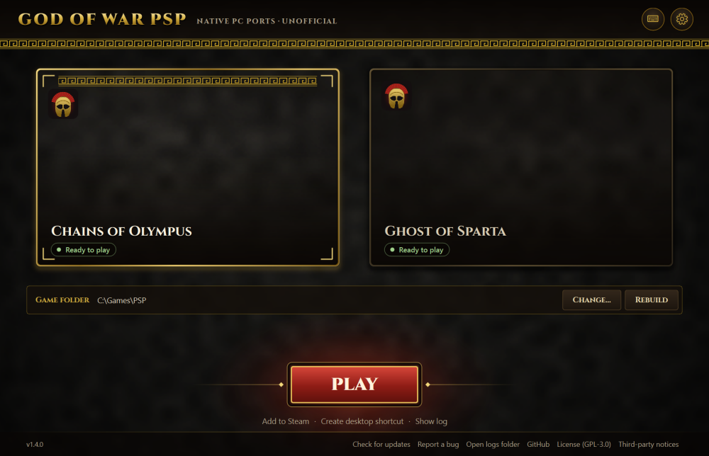
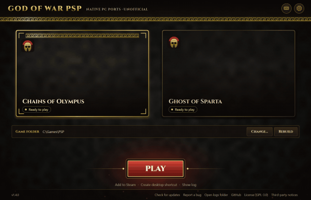
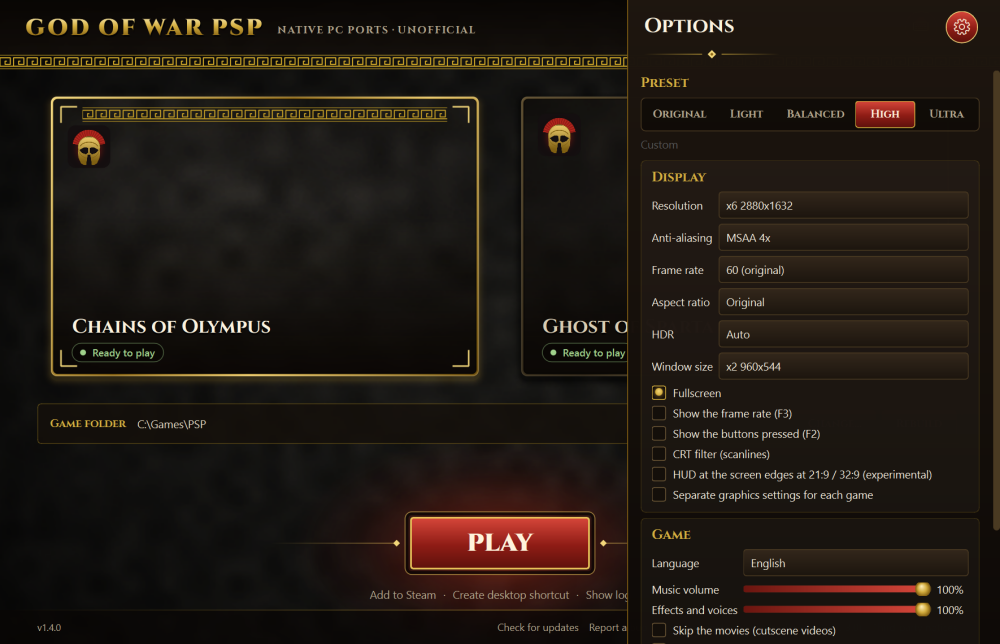
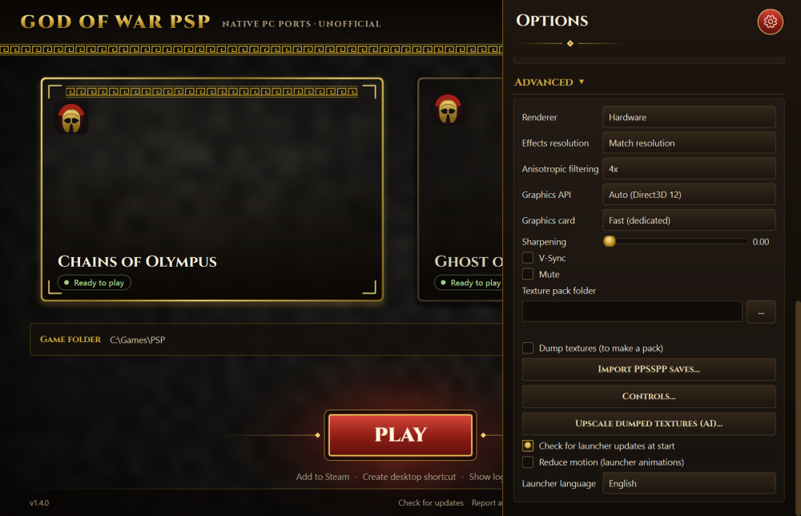
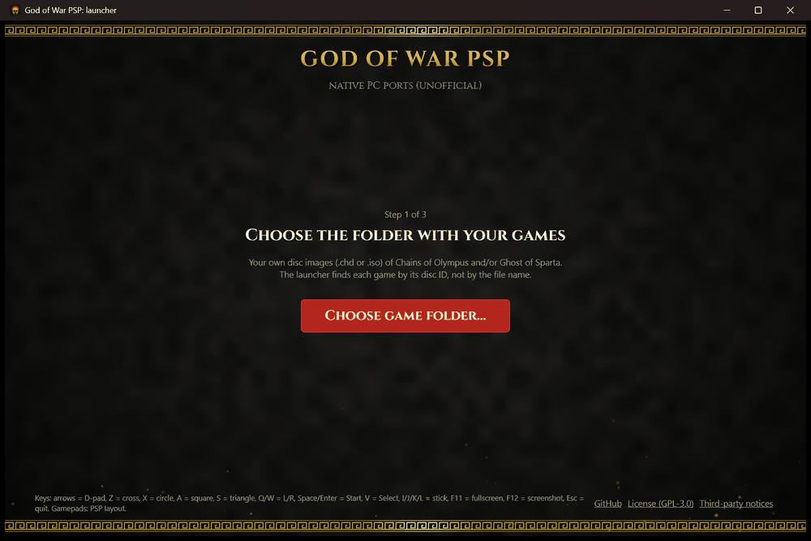

# God of War PSP: native PC ports (unofficial)

[](https://github.com/DrummingBird1/gow-psp-recomp/releases/latest)
[](https://github.com/DrummingBird1/gow-psp-recomp/actions/workflows/launcher.yml)
[](LICENSE)
[](https://github.com/DrummingBird1/gow-psp-recomp/releases)

Play **God of War: Chains of Olympus** and **God of War: Ghost of Sparta** natively on Windows, recompiled from your own
PSP disc, with 4K, MSAA, HDR and high frame rates.

> **Unofficial fan project.** Not affiliated with or endorsed by Sony Interactive Entertainment or Santa Monica Studio.
> God of War is a trademark of its owner. **No game content is included or downloadable here:** you need your own,
> legally dumped disc image (`.chd` or `.iso`) of the US release (UCUS98653 / UCUS98737). Everything built from it stays
> on your PC.



## Status: preview (v1.3.1)

- Every level of both games loads and runs (automated tours: [phase 11](docs/phase11-level-tour.md),
  [phase 12](docs/phase12-gos-level-tour.md)).
- Saving and loading work; sound, music and movies play.
- **No full playthrough of either game yet**, so expect bugs late in a game. Known issues are listed in the
  [phase write-ups](docs/), the [launcher acceptance test](docs/phase14-launcher.md) and the [changelog](CHANGELOG.md).
- Windows only for now (Linux / Steam Deck planned: see the [roadmap](docs/roadmap.md)).

### Known issues

- Neither game has had a full playthrough yet: late levels, boss fights and endings may still have bugs.
- Only the US releases (UCUS98653 / UCUS98737) are supported.
- Warping into Ghost of Sparta's `scb_010_climb` at spawn point 1 (a developer option) stops after a checkpoint restart;
  a normal playthrough does not start there ([phase 12](docs/phase12-gos-level-tour.md), bug 2).
- Some movies end on a black frame, and some Ghost of Sparta geometry clips: both look the same on a PSP and in PPSSPP.
- The launcher is unsigned, so SmartScreen and some antivirus programs warn about it ([FAQ](docs/troubleshooting.md)).

Found something else? See [Reporting a bug](#reporting-a-bug).

Bug reports are very welcome: see [Reporting a bug](#reporting-a-bug) (the log and input files the launcher writes), **never game files or screenshots of the game**.

## Features

- Native executables: every function of the game recompiled to C, no emulator at run time.
- Internal resolution up to 4K (and beyond), MSAA, anisotropic filtering, FXAA, sharpening.
- HDR10 / scRGB output.
- 60, 120, 144 FPS and more (both games step by elapsed time), V-Sync.
- 21:9, 32:9 and 4:3, and a CRT filter (scanlines).
- Keyboard, mouse buttons and gamepads (PSP layout, the right stick evades), saves, texture dump and replacement packs.
- Ghost of Sparta in English, French or Spanish; separate music and effects volume; gamepad rumble; import of PPSSPP
  saves; AI-upscaled texture packs made on your PC; the launcher in English, Spanish, French or Hebrew.
- A one-download launcher: finds your disc images, builds each game, graphics presets, Play.



## Quick start

You only download **one file**, the launcher. No Python, no manual setup.

1. Download [`GoW_PSP_Launcher-v1.3.1.zip`](https://github.com/DrummingBird1/gow-psp-recomp/releases/latest/download/GoW_PSP_Launcher-v1.3.1.zip)
   from the [latest release](https://github.com/DrummingBird1/gow-psp-recomp/releases/latest) and extract it anywhere: you get
   one `GoW_PSP` folder with `GoWLauncher.exe` and a short `README.txt`.
   Everything the launcher creates (sources, builds, saves, settings) goes into `GoW_PSP_data` next to the exe, so
   even a launcher started straight from Downloads adds only that one folder.
2. Run `GoWLauncher.exe` and choose the folder with **your own disc images** (`.chd` or `.iso`). It detects each game by its disc ID,
   not by the file name.
3. Press **Build**. The first time, the launcher asks to download its portable build tools (**about 246 MB**, once;
   about 550 MB unpacked): [llvm-mingw](https://github.com/mstorsjo/llvm-mingw) (Clang compiler), CMake and Ninja,
   from their official releases, checked against pinned SHA-256 hashes. They stay in `GoW_PSP_data`; **no Visual
   Studio, no administrator rights, nothing installed in Windows.**
4. Wait for the one-time build: about 4 minutes for the first game (including the download) and under 3 for the
   second, on a 20-thread CPU.
5. Pick a graphics preset and press **Play**.

> **Windows warning?** `GoWLauncher.exe` is unsigned and built with PyInstaller, so Windows SmartScreen may show
> "Windows protected your PC" (click **More info**, then **Run anyway**), and some antivirus programs flag
> PyInstaller programs as a false positive. Check that your download is the real one (v1.3.1 SHA-256):
> - `GoW_PSP_Launcher-v1.3.1.zip`: `ab947409ce82a15153d3441c394a09e58553f9c32b0d6cd48540cc2fbf2990f8`
> - `GoW_PSP\GoWLauncher.exe`: `b075c4a67343a11dd900c44339fd9a7345d2bd2ccf4fc5bf32bb3aaade8d584f`
>
> (PowerShell: `Get-FileHash <file>`). Each release lists its hashes in the release notes.

The launcher opens no console window. Its command-line options (`GoWLauncher.exe --version`, `--check-update`,
`--update`, `--build coo`) print in the terminal you start them from (in PowerShell, use
`Start-Process -Wait -NoNewWindow .\GoWLauncher.exe --version` to wait for it), or else to
`GoW_PSP_data\build\launcher_cli.log`.

The game starts in fullscreen (F11 or Alt+Enter switches to a window; the launcher's Fullscreen option sets the
default) without a console window. What it prints goes to `GoW_PSP_data\build\launcher_coo.log` (or
`launcher_gos.log`), your button presses of that session to `launcher_coo_input.txt` (or
`launcher_gos_input.txt`), and each frame's timings to `launcher_coo_perf.csv` (or `launcher_gos_perf.csv`). The next
Play overwrites them, so copy them right after the bug happens.

### Reporting a bug

Open an [issue](https://github.com/DrummingBird1/gow-psp-recomp/issues/new/choose), say which level and what happens, and
attach those two files from `GoW_PSP_data\build\`. They hold only text: the game's log and your key presses.
Mention whether you started from a new game or a save. Never attach game files, saves or screenshots of the game.

Problems? See [Troubleshooting and FAQ](docs/troubleshooting.md): SmartScreen, where files are, updating, build
failures, stutter.

Why build on your PC? The game code is generated from your own disc, so it can't be distributed; the launcher
compiles it locally, once.

| | |
|---|---|
|  |  |

### Controls

| Keyboard | PSP | Gamepad |
|---|---|---|
| Arrows | D-pad | D-pad |
| Z / X / A / S | Cross / Circle / Square / Triangle | A / B / X / Y (PSP layout) |
| Q / W | L / R | shoulders or triggers |
| Space or Enter | Start | Start |
| V | Select | Back |
| I / J / K / L | analog stick | left stick |
| O / U (hold) | spin the analog stick clockwise / counter-clockwise, for the "rotate the stick" prompts | rotate the left stick |
| C (hold) | turbo: the face buttons and L/R you hold press and release 10 times a second, for the "press repeatedly" prompts | right stick click |
| | evade (L + R + stick) | right stick |

- **Skip a movie:** Enter, Space, a mouse click, or gamepad Start or Cross. The game goes on to the menu or level as if
  the movie had ended; the press that skipped isn't passed on to the game.
- **Quit:** Alt+F4 or the window's close button quit at once. Esc asks "Quit the game?" with the game paused: Enter or
  gamepad Cross = yes, Esc or gamepad Circle = no. On a gamepad, hold Back + Start for 2 seconds. The game saves only
  at its own save points, so quitting loses progress since the last save. The launcher comes back when the game exits.
- F11 or Alt+Enter: fullscreen / window. F12: screenshot. F3: frame rate in the corner. F2: the buttons pressed,
  bottom left.
- **Change them** with the launcher's *Controls…* button (Options > Advanced): keys, mouse buttons and gamepad
  buttons. A key you give to a button leaves the button that had it, so WASD can move without also blocking (W is R
  by default). The right stick's evade can be turned off there.

While the game runs, the launcher minimizes itself and stops its animation, so it doesn't take time from the game.

## Build from source

Install Python 3.15. For the compiler, either let the launcher download its portable toolchain (llvm-mingw, CMake,
Ninja; `GOW_TOOLCHAIN=portable`, or `python tools/check_portable_toolchain.py`), or install CMake and Visual Studio
2022 or later (or its Build Tools) with the C++ workload; run from source, the launcher uses Visual Studio when it
finds it (`GOW_TOOLCHAIN=auto`, the default; `msvc` forces it). Both produce identical software-renderer output.
Then:

```bash
py -3 -m venv .venv
.venv/Scripts/python -m pip install -r tools/requirements-dev.txt
.venv/Scripts/python tools/launcher.pyw            # the launcher UI
.venv/Scripts/python tools/launcher.pyw --build coo # or build from the command line (coo / gos)
.venv/Scripts/python tools/build_launcher.py        # GoWLauncher.exe (PyInstaller)
```

Details: [`recomp/README.md`](recomp/README.md). The research setup (Ghidra, PPSSPP references) is under
[Research and development](#research-and-development).

## How it works

This is a **static recompilation**, not an emulator. The game's MIPS (Allegrex) code is decrypted from your disc and
every function is translated ahead of time into C (`recomp/`), which is compiled with the C runtime (`runtime/`) into a
normal Windows program. The runtime replaces the PSP's operating system and hardware: threads and kernel objects,
the file system (reading straight from your `.chd` / `.iso`), the VFPU, the GE graphics chip (a software renderer and
a hardware renderer on SDL3 GPU / Direct3D 12 / Vulkan), sound, ATRAC3+, movies and saves. Because the GE output is
redrawn on the PC's GPU, it can render at any resolution and frame rate.



## Research and development

### Layout

| Path | Contents |
|---|---|
| `docs/` | Player FAQ, feasibility report and phase write-ups ([index](docs/README.md)) |
| `re/scripts/` | Ghidra scripts (analysis export, metrics, import naming, function seeding) and `build_nid_db.mjs` |
| `re/out/` | Analysis results: metrics, function lists, imports, NID table (no game code) |
| `recomp/` | Recompiler (Python): loader/relocator, decoder, C emitter, driver, differential tests |
| `runtime/` | C runtime the generated code links against |
| `CMakeLists.txt` | Builds `gow_rt_<GAME>` from `build/gen/<GAME>` |
| `cmake/` | Pinned file lists (SHA-256) of third-party sources CMake downloads, e.g. OpenH264's decoder |
| `tools/` | `launcher.pyw` (build and play), play/replay scripts, level tour, frame checks, documentation helpers |

Local only (ignored): `*.chd`, `re/dumps/`, `re/ghidra/`, `build/`, `.venv/`, `re/ppsspp-*`, `media/` (screenshots and recordings; see [`docs/progress.md`](docs/progress.md)).

### Setup on a new machine

1. Tools: Ghidra 12.1.3 + ghidra-allegrex v21.4, JDK 21 and Python 3.15 for the analysis. For compiling, the portable
   toolchain is enough (llvm-mingw, CMake, Ninja: `python tools/check_portable_toolchain.py` downloads it, or
   `GOW_TOOLCHAIN=portable`); Visual Studio 2022+ with the C++ workload and CMake also works. Git is only needed to
   clone this repository: the build downloads its third-party sources as pinned archives.
2. Decrypted EBOOT: the launcher does this for you (into `build/eboot/`). By hand, build `gow_disc`
   (`cmake -S . -B build/cmake_tools -DGOW_TOOLS_ONLY=ON` then `cmake --build build/cmake_tools --config Release`) and run
   `build/cmake_tools/Release/gow_disc.exe --disc <your disc>.chd --decrypt-eboot re/dumps/UCUS98653_EBOOT.BIN`
   (`UCUS98737_EBOOT.BIN` for Ghost of Sparta). A PPSSPP dump (`DumpFileTypes = 3`) gives the same bytes and is no
   longer needed.
3. Python environment for the tests: `py -3 -m venv .venv` then `.venv/Scripts/python -m pip install unicorn`.
4. PPSSPP reference sources used by `build_nid_db.mjs` (optional, re-fetchable):
   `Core/HLE/*.cpp` (and, for the movies, `Core/HW/MediaEngine.*` and `Core/HW/MpegDemux.*`) into `re/ppsspp-hle/`, `Core/MIPS/MIPSInt.cpp` and `MIPSTables.cpp` into `re/ppsspp-mips/`,
   and the GE references (`GPU/Software/*`, `GPU/GPUState.*`, `GPU/ge_constants.h`, `GPU/Common/VertexDecoderCommon.*`,
   `GPU/Common/TextureDecoder.*`, `GPU/GPUCommon*.cpp`) into `re/ppsspp-gpu/`, and the audio references
   (`Core/HW/SasAudio.*`, `Core/HW/SasReverb.*`, `Core/HW/Atrac3Standalone.*`, `Core/HLE/AtracCtx2.h`,
   `Core/Util/AtracTrack.*`, `ext/at3_standalone/`) into `re/ppsspp-audio/` (tag v1.20.4).
5. For progress screenshots and recordings: `.venv/Scripts/python.exe -m pip install pillow numpy`, and ffmpeg.

See [`recomp/README.md`](recomp/README.md) for the recompile/build/test commands and
[`docs/`](docs/) for results.

## Contributing

Questions, ideas and help: [Discussions](https://github.com/DrummingBird1/gow-psp-recomp/discussions). Bugs:
[Issues](https://github.com/DrummingBird1/gow-psp-recomp/issues). Contributions are welcome: see [`CONTRIBUTING.md`](CONTRIBUTING.md). **Never attach or commit game files.** Releases
are numbered `vMAJOR.MINOR.PATCH`, roughly following semantic versioning, and are listed in [`CHANGELOG.md`](CHANGELOG.md).

## Credits

- [PPSSPP](https://www.ppsspp.org/): the reference for the PSP's hardware and HLE; parts of it are ported in the runtime
  (GPL-2.0-or-later), and its `at3_standalone` decoder and PrxDecrypter are used.
- libkirk (PSP crypto), libchdr, SDL3, OpenH264.
- [Cinzel](https://fonts.google.com/specimen/Cinzel) font (SIL Open Font License).
- [Qt for Python / PySide6](https://doc.qt.io/qtforpython/) (LGPL-3.0, linked dynamically) for the launcher.
- The icon is original art (`tools/make_icon.py`).

## License

GPL-3.0-or-later (see [`LICENSE`](LICENSE)). CMake downloads the third-party sources at configure time (SDL3, libchdr,
OpenH264, PPSSPP's `at3_standalone` and `libkirk`) with pinned SHA-256s; they keep their own licenses and are not part
of this repository. The launcher ships its third-party notices (`tools/launcher_assets/THIRD_PARTY_NOTICES.txt`).
